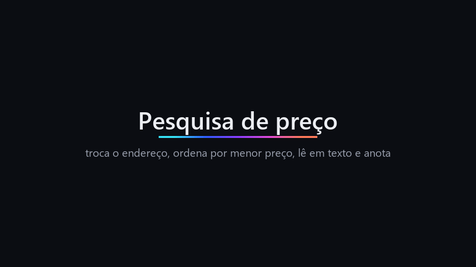
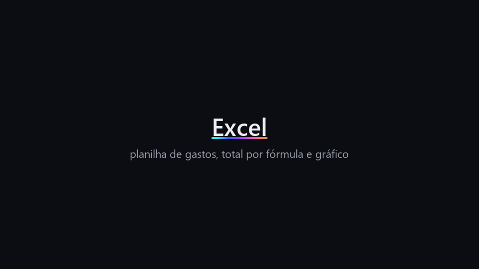
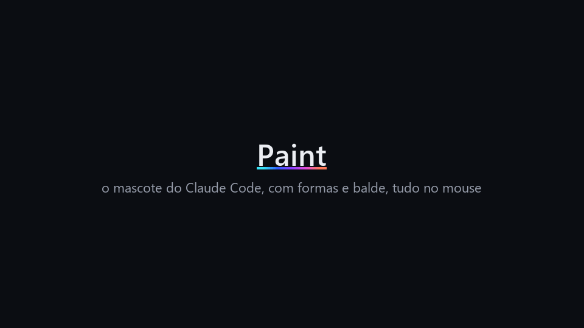
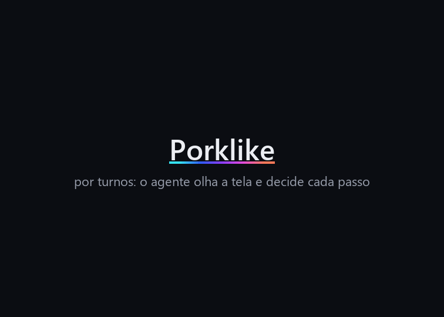

<div align="center">


# Tato Runtime

The hands of an AI agent: a computer and a browser for any agent that speaks MCP.

Claude Code · Codex · Cursor · Gemini CLI

**English** · [Português (BR)](README.pt-BR.md)

</div>

<p align="center">
  
</p>

Tato Runtime is an MCP server that gives the agent three tools: `computador`
(computer), `browser` and `gravacao` (recording). The agent decides what to do;
Tato reads the interface, performs the gesture, checks that it took effect and
returns the result. Whenever it can, it reads the screen's structure as text
before falling back to an image, which makes each step cheaper and more
accurate.

While the agent uses the machine, a frame shows what it is doing, and a
shortcut stops everything instantly.

> Tool names, actions, parameters and environment variables are in Portuguese,
> exactly as the agent sees them. This README keeps them as-is and explains
> them in English.

## What it does

### Computer

- **Sees through structure:** reads the window's elements through the system's
  accessibility layer (UI Automation on Windows, AT-SPI on Linux) and the text
  of the foreground window, with term search. It only falls back to a
  screenshot when the structure isn't enough, and can crop and zoom into a
  small region of the screen.
- **Uses mouse and keyboard:** clicks by element number or by coordinate,
  types, presses key combinations, holds keys, sends key sequences in a single
  call, drags with the middle button and modifiers, scrolls.
- **Checks every gesture:** after acting, it compares the screen with the one
  before and says whether the gesture worked, whether something changed or
  whether nothing happened, so the agent doesn't repeat a click that already
  worked.
- **Finds programs:** lists what is open, in the tray and installed, brings a
  window to the front and opens programs through the system menu.
- **Waits for the screen:** for a fixed time or until the screen changes,
  ignoring things that animate on their own.

<p align="center">
  
</p>

It also draws: in Paint, the Claude Code mascot comes out of shapes, the
bucket fill and the mouse.

<p align="center">
  
</p>

### Browser

- The Chrome extension opens **a dedicated tab per conversation**, in a group
  named after the agent. The agent can't reach the person's other tabs.
- Reads the page through the accessibility tree, the DOM, structured data and
  the console, and only takes a screenshot when text isn't enough.
- Clicks, fills, scrolls and runs **scripts** (`roteiro`): a sequence of steps
  with checks in between, which stops at the first step that fails.
- Through the screen, it can browse in the person's Chrome or in a separate
  profile just for the agent (see [Configuration](#configuration)).

### Local recording

- When the person asks to record a demo, `gravacao` starts capturing **after
  specific approval**. An always-visible notice shows that the screen is being
  recorded and has a **Stop** button. If the notice doesn't open, there is no
  capture.
- `parar` (stop) finishes it; `estado` (status) says whether capture is still
  running. `ver` (view) returns **a contact sheet with up to 12 frames**. In
  `mudancas` (changes) mode, it shows the moments before and after the biggest
  changes within a window of up to 30 seconds. You can zoom into an `area` and
  narrow `de`/`ate` (from/to) in new calls — useful for investigating something
  that appears and disappears without sending hundreds of images to the agent.
- `montar` (assemble) builds a GIF with cuts, speed, captions, title cards,
  cropping, shortened waits and blur by interval. A segment with a different
  `id` joins finished local recordings in the given order.
- Frames and the GIF stay only in `TATO_HOME/gravacoes/<id>`. Tato doesn't send
  them anywhere, doesn't publish them and stops capture if the MCP connection
  closes. Capture stops automatically within 15 minutes. Recording through MCP
  is available on Windows in this first version.

For example, after `iniciar` (start) and `parar`, the agent can look for a
quick change and assemble only the chosen moments:

```json
{"acao":"ver","id":"<id returned by iniciar>","modo":"mudancas",
 "de":12,"ate":22,"area":[200,100,700,500],"amostras":8}
```

```json
{"acao":"montar","id":"<id returned by iniciar>","trechos":[
  {"titulo":"Price research"},
  {"de":12,"ate":35,"velocidade":3,"legenda":"Comparing the offers",
   "borrar":[
    {"de":15,"ate":19,"caixa":[10,20,150,80]}]}
]}
```

`TATO_GRAVAR=1` mode, set **before starting the server**, includes the
computer frame in the video; without it, the frame stays out of the capture.
The recording notice stays visible in both modes. The GIF is for local review:
check for personal data before sharing it.

## You're in control

- **Frame on screen:** a border, its own pointer in place of the cursor, a
  bubble with the gesture and a small box with the agent's messages, since the
  chat sits behind the window. The frame stays out of the screenshots the
  agent sees.
- **Stop shortcut:** `Ctrl + Alt + Shift + S` interrupts the gesture in
  progress, and no gesture runs after it. The agent can't trigger this
  shortcut.
- **Approval:** the first gesture of each turn asks for approval through the
  MCP client. Reads don't.
- **Doesn't type in the wrong place:** if another window comes to the front,
  the keyboard stops, even in the middle of a text.
- **One agent at a time:** two clients don't fight over the same mouse and
  keyboard.
- **What it never does:** type a password (the agent clicks the field and uses
  the browser's autofill) or press combinations that kill the session or delete
  irreversibly. Login and verification codes are handed to the person with
  `pedir_a_pessoa` (ask the person).
- **In the browser:** it opens web pages (http or https), local ones included,
  so the agent can check the site you are building. Other schemes, like
  `file://`, are refused, and actions that submit data or have consequences ask
  for approval.

## Turn-based games

<p align="center">
  
</p>

Turn-based games work well: the game waits while the agent looks and decides.
The agent sends several moves in one sequence and reads a zoomed-in crop of
the screen to see what is drawn.

Games in the demo, free and distributed by their own authors, running on the
mGBA emulator:

- **Porklike**, by Krystian Majewski and Lazy Devs, Game Boy version by Ben Smith.
- **Tobu Tobu Girl Deluxe**, by Tangram Games, open source.
- **Libbet and the Magic Floor**, by Damian Yerrick, based on Martin Korth's
  Magic Floor, free software (zlib license).

Real-time games aren't its strength: each look-and-decide loop takes a few
seconds. In the Tobu Tobu Girl clip the agent pauses the emulator to think.

## Install

Requirements: Python 3.11 or newer; Windows 10 or 11, or Linux with X11;
Google Chrome for the browser.

```bash
git clone https://github.com/Ryanleoncoder/tato-runtime.git
cd tato-runtime
pip install -e .
```

Tato runs with `python -m tato`. In the examples below, `python` is the Python
you installed it into; if you used a venv, put the path to its Python.

### Register with your agent

**Claude Code**

```bash
claude mcp add tato -- python -m tato --aprovacao-no-cliente
```

**Codex**, in `~/.codex/config.toml`:

```toml
[mcp_servers.tato]
command = "python"
args = ["-m", "tato"]
```

**Cursor** (`~/.cursor/mcp.json`) and **Gemini CLI** (`~/.gemini/settings.json`):

```json
{
  "mcpServers": {
    "tato": { "command": "python", "args": ["-m", "tato"] }
  }
}
```

`--aprovacao-no-cliente` (approval in the client) is for clients that already
ask for approval before each tool call, like Claude Code. Without it, Tato asks
through the MCP protocol itself.

### Browser extension

Once only: in `chrome://extensions`, turn on developer mode, choose "Load
unpacked" and select the `tato/extensao` folder. It connects on its own when
the agent starts Tato. Details in the
[extension guide](tato/extensao/README.md) (in Portuguese).

## Configuration

Everything through environment variables, with defaults that work without any
setup.

| Variable | Default | What it does |
|---|---|---|
| `TATO_COMPUTADOR_ATALHO` | `ctrl+alt+shift+s` | Stop shortcut. |
| `TATO_COMPUTADOR_RITMO` | `1` | With `0`, the automatic pace types fast in every program, not only in editors. |
| `TATO_COMPUTADOR_DESLIZAR` | `1` | The mouse glides to the target; `0` jumps straight there. |
| `TATO_GRAVAR` | `0` | With `1`, the frame shows up in screen recordings (OBS, Xbox Game Bar, Snipping Tool). It also appears in the screenshot the agent receives. Windows only. |
| `TATO_NAVEGADOR_PERFIL` | `pessoa` | Which Chrome to browse through the screen: `pessoa` (yours, with your accounts) or `agente` (separate profile). |
| `TATO_NAVEGADOR_AGENTE_NOME` | `Agente` | Name of the separate profile: it becomes "Chrome do <name>". Create the shortcut with `python -m tato.computador.perfil_do_agente <name>`. |
| `TATO_BROWSER_OCIOSO_MIN` | `0` | Closes the browser session after this many idle minutes; `0` never closes it. |
| `TATO_PORTA` | `47812` | Local port where the extension finds Tato. |
| `TATO_HOME` | `~/.tato` | Where Tato keeps what it needs between runs. |

## Actions

### `computador`

| Action | What it does |
|---|---|
| `ver` | Screenshot; with `marcar`, numbers the elements; with `regiao`, crops and zooms. |
| `elementos` | Elements of the focused window through accessibility, no image. |
| `ler` | Text of the foreground window; with `procurar`, only the lines containing the term. |
| `janelas` | Open windows and which one has focus. |
| `programas` | Programs that are open, in the tray and installed. |
| `abrir` / `focar` / `fechar` | Opens a program through the system menu / brings a window to the front / closes a window like its X button (the program still asks whether to save). |
| `clicar`, `clicar_duas`, `clicar_direito`, `mover` | Click, double-click, right-click, move — by element number or screenshot coordinate. A coordinate click after other gestures checks that the screen around the target still matches the screenshot; `confiar_no_print` allows it when the change is expected. |
| `arrastar` / `rolar` | Drag / scroll, with button and modifiers. |
| `digitar` | Types text into the focused field, with `ritmo` (pace): `natural` (human-like pauses, for websites), `rapido` (fast), `instantaneo` (all at once) or `automatico` (fast in local editors, natural elsewhere). |
| `tecla` | A key combination, held for a while, or a `sequencia` (sequence) of keys. Accepts letters, numbers, special keys and `= - , .` (zoom is `ctrl+=` and `ctrl+-`). |
| `invocar` / `definir_valor` | Triggers or fills an element through accessibility, without the mouse. |
| `esperar` | Waits a fixed time or `ate_mudar` (until it changes). |
| `pedir_a_pessoa` / `encerrar` | Hands over to the person / releases the session. |

Every gesture accepts `dizer` (say): a short sentence that appears in the
frame's message box.

### `browser`

| Action | What it does |
|---|---|
| `navegar` | Opens an address and returns the page tree with references. |
| `snapshot` | Reads the page again. |
| `clicar` / `digitar` / `rolar` | Click / type / scroll, by the element's reference or text. |
| `roteiro` | Several steps at once, with `esperar`, `conferir` and `pensar` (wait, check, think) in between. |
| `imagens` | Screenshot of the page, when text isn't enough. |
| `console` | The page's console messages. |
| `encerrar` | Ends the browser session. |

### `gravacao`

| Action | What it does |
|---|---|
| `iniciar` | Starts recording the screen, with approval and a visible notice; accepts `fps`, `largura` (width), `caixa` (box) and `minutos` (minutes). |
| `parar` / `estado` | Finishes the recording / says whether it's still running. |
| `ver` | A contact sheet with up to 12 frames, by `intervalo` (interval) or by the biggest `mudancas` (changes), with `de`, `ate` and `area`. |
| `montar` | Builds the GIF from `trechos` (segments: cuts, title cards, captions, speed, crop, blur); `nome` names the file. |

## How it works

- On connection, the server sends the agent, as MCP instructions, what applies
  to all three tools: which one to use, talking through the frame, handing
  login to the person and ending when done. Each tool describes only its own
  usage.
- The server speaks MCP over stdio. Each call sends progress and accepts
  cancellation; a call that doesn't return in time is abandoned and the agent
  receives the reason.
- The first Tato to start opens the extension's local port; the others relay
  their commands through it.
- The frame stays on screen while the session is open; `encerrar` removes it.

## Limitations

- Real-time games: too slow for the look-and-decide loop.
- Online games: don't. Automating matches is forbidden in most games, and
  anti-cheat systems detect simulated input.
- Administrator windows: Windows doesn't let a regular program control an
  elevated window.
- macOS and Linux with Wayland aren't supported yet.

## Development

```bash
pip install -e ".[dev]"
python -m pytest
node --test tato/extensao/service-worker.test.cjs
```

The Linux tests (X11 and AT-SPI) only run where Xvfb is available; on Windows
they are skipped.

## License

[MIT](LICENSE).
